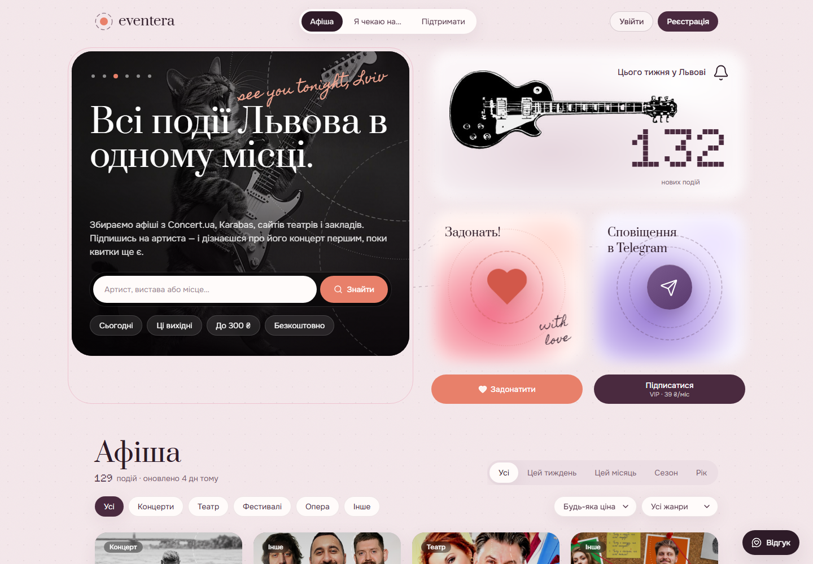
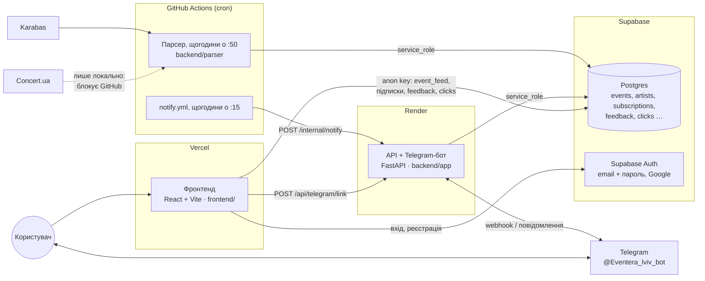

# Eventera

> **In English.** Eventera is a website that collects concerts and theatre events in Lviv from separate
> ticket sites and shows them in one place. Add an artist to your “I'm waiting for…” list and the Telegram bot
> tells you as soon as their Lviv event appears. Built by three students for a university project:
> React + Supabase frontend on Vercel, a Python parser on GitHub Actions, and a FastAPI backend with a Telegram
> bot on Render. The rest of this README is in Ukrainian.

**Eventera** збирає концерти й вистави Львова з різних сайтів продажу квитків і показує їх в одному місці.
Наша мета — щоб людина не пропускала подій, які їй важливі, і не мусила для цього стежити за десятками сайтів.
Додай артиста до списку «Я чекаю на…», і бот у Telegram напише, щойно в нього з'явиться подія у Львові.

**Живе демо:** https://eventera-lviv.vercel.app · **Бот:** [@Eventera_lviv_bot](https://t.me/Eventera_lviv_bot) ·
**API:** https://eventera-api-hbgc.onrender.com/health



## Зміст

1. [Функції](#функції)
2. [Архітектура](#архітектура)
3. [Структура репозиторію](#структура-репозиторію)
4. [Запуск локально](#запуск-локально)
5. [Змінні середовища](#змінні-середовища)
6. [Деплой](#деплой)
7. [Команда](#команда)
8. [Фото й ліцензії](#фото-й-ліцензії)
9. [Що далі](#що-далі)

## Функції

- **Афіша Львова.** Концерти, театр, фестивалі, опера з Karabas і Concert.ua. Одна подія, знайдена на двох
  сайтах, показується один раз з обома посиланнями на квитки. Парсер оновлює дані щогодини.
- **Фільтри й пошук:** період (тиждень / місяць / сезон / рік), категорія, ціна, «Безкоштовно», жанр,
  пошук за артистом, виставою або місцем. Афіша підвантажує по 12 подій.
- **Сторінка події:** дата, місце, ціна, статус квитків, схожі події, посилання на квитки на сайті-джерелі.
- **Реєстрація і вхід** (Supabase Auth): email + пароль, підтвердження пошти, відновлення пароля,
  опційно вхід через Google.
- **«Я чекаю на…».** Список артистів, подій або ключових слів. Безкоштовно — до 3 записів.
- **Сповіщення в Telegram** через [@Eventera_lviv_bot](https://t.me/Eventera_lviv_bot): прив'язка акаунта
  в один клік, повідомлення про нову подію, керування списком прямо в боті (`/list`, `/settings`).
- **VIP-підписка, 39 ₴/міс:** необмежений список, нагадування за день до події, ліміт ціни для сповіщень,
  бейдж VIP. Оплата — через банку monobank, підтвердження вручну (див. [infra/README.md](infra/README.md#як-підтвердити-vip)).
- **Донат** на «Повернись живим»: банка monobank і QR-код на сторінці «Підтримати».
- **Відгуки та аналітика:** кнопка «Відгук» (оцінка, що сподобалось, чи оформив(-ла) би VIP) і лічильник
  кліків по донату, VIP, квитках і Telegram. Дані лягають у таблиці `feedback` і `clicks` для звіту.
- **Сайт не падає без бекенду:** якщо Supabase недоступний або не налаштований, фронтенд показує демо-події
  з `frontend/src/mocks/events.ts`.

## Архітектура



Як це працює:

1. **Парсер** (`backend/parser/`, Python) щогодини запускається в GitHub Actions, завантажує афіші, приводить їх
   до спільного формату, склеює дублікати з різних сайтів і пише в Supabase ключем `service_role`.
2. **Supabase** зберігає події, профілі, списки «Я чекаю на…», прив'язки Telegram, відгуки й кліки.
   Права на рядки (RLS) дозволяють браузеру читати афішу й змінювати лише власні дані.
3. **Фронтенд** (Vercel) читає афішу з view `event_feed` напряму через Supabase JS з публічним `anon`-ключем.
   Вхід і реєстрація — через Supabase Auth.
4. **Бекенд** (Render) — це FastAPI + Telegram-бот. Сайт звертається до нього лише по одноразове посилання
   для прив'язки Telegram. Щогодини о :15 GitHub Actions викликає `/internal/notify`, і бот розсилає
   повідомлення з черги `notification_queue`.

Безкоштовний Render засинає після ~15 хв без запитів, тому перше звернення може тривати до хвилини.
Сайт показує спінер «Прокидаємо бота…».

## Структура репозиторію

```
.
├── frontend/              Сайт: Vite + React + TypeScript + Tailwind
│   ├── src/pages/         Сторінки: головна, подія, «Я чекаю на…», вхід, «Підтримати»
│   ├── src/components/    UI-компоненти (картки, плитки, модалки VIP і відгуку)
│   ├── src/lib/           Supabase-клієнт, запити до даних, авторизація, хуки
│   ├── src/mocks/         Демо-події на випадок, коли бази немає
│   ├── public/images/     Фото для hero, категорій і сторінки входу
│   └── vercel.json        SPA-rewrite: усі шляхи → index.html
├── backend/
│   ├── parser/            Парсер афіш Karabas і Concert.ua → Supabase (див. backend/parser/README.md)
│   └── app/               FastAPI + Telegram-бот @Eventera_lviv_bot (див. backend/README.md)
├── supabase/
│   ├── migrations/        Основна схема БД: події, артисти, профілі, підписки, Telegram, VIP
│   └── seed.sql           Демо-події для локальної бази
├── infra/
│   ├── supabase/schema.sql      Таблиці feedback, clicks, vip_requests + RLS + RPC (накочується після міграцій)
│   ├── *.Dockerfile, nginx.conf Docker-образи frontend, backend, parser
│   ├── docker-compose.yml       Локальний запуск усього разом
│   ├── render.yaml              Render Blueprint для бекенду
│   └── README.md                Деталі інфраструктури, підтвердження VIP
├── .github/workflows/
│   ├── ci.yml             Lint, тести і збірка фронтенду, збірка Docker-образів (кожен push)
│   ├── parser.yml         Парсер щогодини о :50
│   └── notify.yml         Розсилка сповіщень щогодини о :15
├── design/                Макети (PNG) і one-pager продукту (Event_era.pdf)
├── docs/                  Скріншот для README
├── .env.example           Шаблон кореневого .env для Docker Compose
└── CLAUDE.md              Інструкції для AI-асистента (продукт, правила, дизайн)
```

## Запуск локально

### Вимоги

| Що | Версія | Для чого |
|---|---|---|
| [Git](https://git-scm.com/) | будь-яка | клонувати репо |
| [Node.js](https://nodejs.org/) | **22 LTS** або новіша (Vite 8 потребує ≥ 20.19) | фронтенд |
| [Python](https://www.python.org/) | **3.12+** | парсер і бекенд |
| [Docker Desktop](https://www.docker.com/products/docker-desktop/) | Compose v2 | лише для запуску через Docker |

```bash
git clone https://github.com/anastasiialem/Eventera.git
cd Eventera
```

### Фронтенд

```bash
cd frontend
npm ci                       # встановити залежності з package-lock.json
cp .env.example .env.local   # необов'язково: впиши ключі Supabase
npm run dev                  # http://localhost:5173
```

Без ключів Supabase (або зі значеннями-заглушками з `.env.example`) сайт показує демо-події, а вхід
вимкнений. Щоб працювали вхід і справжня афіша, впиши `VITE_SUPABASE_URL` і `VITE_SUPABASE_ANON_KEY`
(див. [Змінні середовища](#змінні-середовища)).

Інші команди:

```bash
npm run lint      # oxlint
npm test          # vitest
npm run build     # перевірка типів + продакшн-збірка в dist/
npm run preview   # подивитися збірку локально
```

### Бекенд і парсер

```bash
cd backend
python -m venv .venv

# активувати віртуальне середовище:
source .venv/bin/activate        # macOS / Linux
source .venv/Scripts/activate    # Windows (Git Bash)
.venv\Scripts\Activate.ps1       # Windows (PowerShell)

pip install -r parser/requirements.txt -r app/requirements.txt
cp .env.example .env             # впиши ключі (див. таблицю нижче)
```

**Тести** (без інтернету й без бази):

```bash
python -m pytest parser/tests app/tests
```

**Парсер:**

```bash
python -m parser.run                   # лише показати, що знайшлося (ключі не потрібні)
python -m parser.run --json out.json   # зберегти у файл
python -m parser.run --db              # записати в Supabase (потрібні SUPABASE_URL і SUPABASE_SERVICE_ROLE_KEY)
```

Джерела можна обмежити змінною `PARSER_SOURCES=karabas` (або `concert_ua`).

**API + Telegram-бот.** Під час старту API звертається до Telegram (`getMe`), тому в `backend/.env` мають бути
справжні значення **всіх** змінних: `SUPABASE_URL`, `SUPABASE_SERVICE_ROLE_KEY`, `TELEGRAM_BOT_TOKEN`,
`TELEGRAM_WEBHOOK_SECRET`, `INTERNAL_API_KEY`. З вигаданим токеном сервер не стартує.

```bash
uvicorn app.main:app --reload    # API на http://localhost:8000, перевірка: /health
python -m app.polling            # бот відповідає в Telegram з твого комп'ютера
```

> `app.polling` знімає webhook продакшн-бота. Після локальних тестів перезапусти сервіс на Render, і він
> поставить webhook знову. Краще створити окремого тестового бота в [@BotFather](https://t.me/BotFather).

Щоб локальний сайт ходив у локальний бекенд, у `frontend/.env.local` вкажи `VITE_BACKEND_URL=http://localhost:8000`.

### Усе разом через Docker Compose

З кореня репозиторію:

```bash
cp .env.example .env     # заповни значення (коментарі — у файлі)

# frontend → http://localhost:8080, backend → http://localhost:8000/health
docker compose --env-file .env -f infra/docker-compose.yml up --build

# одноразовий запуск парсера (пише в Supabase)
docker compose --env-file .env -f infra/docker-compose.yml --profile jobs run --rm parser
```

- `--env-file .env` обов'язковий: значення `VITE_*` вшиваються у фронтенд під час збірки.
- Бекенд без заповнених `SUPABASE_*`, `TELEGRAM_*` та `INTERNAL_API_KEY` не стартує (див. вище). Фронтенд
  без них збереться й покаже демо-події. Лише фронтенд: `docker compose --env-file .env -f infra/docker-compose.yml up --build frontend`.
- Якщо збірка падає з `CERTIFICATE_VERIFY_FAILED` під час `npm ci` / `pip install`, твоя мережа
  (корпоративний проксі, антивірус) підміняє HTTPS-сертифікати. Контейнери їм не довіряють, тож
  збирай в іншій мережі або вимкни перевірку HTTPS в антивірусі.

## Змінні середовища

Шаблони: [frontend/.env.example](frontend/.env.example) → `frontend/.env.local`,
[backend/.env.example](backend/.env.example) → `backend/.env`, [.env.example](.env.example) → `.env` (Docker Compose).
Усі `.env*` файли в `.gitignore`.

> ⚠️ Усе, що починається з `VITE_`, потрапляє в JavaScript у браузері і його бачить будь-хто. Туди — лише
> публічний `anon`-ключ. Ключ `service_role` обходить усі права доступу: тільки бекенд, парсер і GitHub Secrets.

### Фронтенд

| Змінна | Обов'язкова | Де взяти | Де використовується |
|---|---|---|---|
| `VITE_SUPABASE_URL` | для входу й справжніх даних | Supabase → Project Settings → API → Project URL | Supabase-клієнт (`src/lib/supabase.ts`) |
| `VITE_SUPABASE_ANON_KEY` | для входу й справжніх даних | Supabase → Project Settings → API → `anon` `public` | Supabase-клієнт |
| `VITE_BACKEND_URL` | для кнопки Telegram | адреса сервісу на Render, напр. `https://eventera-api-hbgc.onrender.com` | прив'язка Telegram (`src/lib/api.ts`) |
| `VITE_TELEGRAM_BOT_URL` | ні | `https://t.me/Eventera_lviv_bot` | запасне посилання, якщо бекенд не відповів |
| `VITE_DONATE_URL` | ні | посилання на банку monobank «Повернись живим» | кнопки «Задонатити», QR на `/support` |
| `VITE_VIP_PAY_URL` | ні | посилання на банку monobank «Eventera VIP» | модалка VIP, «Оплатити 39 ₴» |
| `VITE_VIP_NOTE` | ні | свій текст; порожньо → «Гроші з VIP-підписки йдуть на розвиток Eventera» | модалка VIP |
| `VITE_ENABLE_GOOGLE` | ні | `true`, якщо в Supabase увімкнено провайдер Google | кнопка «Продовжити з Google» |
| `VITE_API_URL` | ні, залиш порожньою | адреса окремого API подій | якщо задана, афіша береться з API; порожня — напряму з Supabase |

### Бекенд і парсер

| Змінна | Хто | Де взяти |
|---|---|---|
| `SUPABASE_URL` | парсер, API | Supabase → Project Settings → API → Project URL |
| `SUPABASE_SERVICE_ROLE_KEY` | парсер, API | Supabase → Project Settings → API → `service_role` (**секрет**) |
| `TELEGRAM_BOT_TOKEN` | API | [@BotFather](https://t.me/BotFather) → `/newbot` або `/token` (**секрет**) |
| `TELEGRAM_WEBHOOK_SECRET` | API | випадковий рядок: `python -c "import secrets; print(secrets.token_urlsafe(32))"` |
| `INTERNAL_API_KEY` | API, `notify.yml` | випадковий рядок, так само; однаковий у Render і GitHub Secrets |
| `FRONTEND_URL` | API | адреса сайту: `https://eventera-lviv.vercel.app` (локально `http://localhost:5173`); посилання в боті й CORS |
| `PUBLIC_BASE_URL` | API | публічна адреса для webhook. На Render не потрібна (є `RENDER_EXTERNAL_URL`); локально порожньо |
| `ADMIN_CHAT_IDS` | API | Telegram chat_id адмінів через кому (команда `/admin`); можна порожньо |
| `PARSER_SOURCES` | парсер | `karabas`, `concert_ua` або обидва через кому; порожньо = усі |

### GitHub Secrets

Settings → Secrets and variables → Actions:

| Секрет | Workflow |
|---|---|
| `SUPABASE_URL`, `SUPABASE_SERVICE_ROLE_KEY` | `parser.yml` |
| `BACKEND_URL` (адреса Render), `INTERNAL_API_KEY` | `notify.yml` |

## Деплой

Порядок: **Supabase → Render → Vercel → GitHub Secrets**, бо кожен наступний крок потребує адрес і ключів
із попереднього.

### 1. Supabase (база + вхід)

1. [supabase.com](https://supabase.com) → **New project**. Регіон — найближчий (напр. Frankfurt).
2. Накоти основну схему — файли з `supabase/migrations/` **по черзі за датою в назві**:
   - через [Supabase CLI](https://supabase.com/docs/guides/cli): `supabase link --project-ref <ref>` → `supabase db push`;
   - або вручну: **SQL Editor** → вставити файл → **Run**, і так для кожного.
3. Потім **SQL Editor** → вміст [infra/supabase/schema.sql](infra/supabase/schema.sql) → **Run**
   (таблиці `feedback`, `clicks`, `vip_requests`, RPC `donate_clicks_count()`). Файл можна запускати повторно.
4. **Authentication → URL Configuration:**
   - **Site URL:** `https://eventera-lviv.vercel.app`
   - **Redirect URLs** (сюди Supabase повертає після підтвердження пошти, входу через Google і скидання пароля):
     ```
     https://eventera-lviv.vercel.app/**
     http://localhost:5173/**
     ```
     Сайт використовує `/auth/callback` і `/auth/reset`. Без цього кроку посилання з листа ведуть на `localhost`.
5. **Authentication → Providers → Email** — увімкнено (за замовчуванням). Опційно **Google**: Client ID і Secret
   з Google Cloud Console, Authorized redirect URI — `https://<ref>.supabase.co/auth/v1/callback`; потім `VITE_ENABLE_GOOGLE=true`.
6. **Project Settings → API** — скопіюй Project URL, `anon` і `service_role` для наступних кроків.

### 2. Render (API + Telegram-бот)

1. Створи бота в [@BotFather](https://t.me/BotFather) і збережи токен.
2. [render.com](https://render.com) → **New → Blueprint** → підключи GitHub-репозиторій → Blueprint Path:
   `infra/render.yaml`. Сервіс `eventera-api` (Docker, free plan, гілка `main`).
3. Render попросить значення змінних: `SUPABASE_URL`, `SUPABASE_SERVICE_ROLE_KEY`, `TELEGRAM_BOT_TOKEN`,
   `TELEGRAM_WEBHOOK_SECRET`, `INTERNAL_API_KEY`, `ADMIN_CHAT_IDS`, `FRONTEND_URL=https://eventera-lviv.vercel.app`.
4. Після деплою сервіс сам ставить webhook у Telegram. Перевір:
   `https://<сервіс>.onrender.com/health` → `{"ok": true, "bot": "Eventera_lviv_bot"}`, потім напиши боту `/start`.

Кожен push у `main` перезбирає сервіс автоматично. Детальніше — [backend/README.md](backend/README.md).

### 3. Vercel (фронтенд)

Проєкт на Vercel називається **`eventera-lviv`** і деплоїться через [Vercel CLI](https://vercel.com/docs/cli):

1. **Settings → Environment Variables** (середовище *Production*) — додай змінні з таблиці
   [Фронтенд](#фронтенд-1): `VITE_SUPABASE_URL`, `VITE_SUPABASE_ANON_KEY`,
   **`VITE_BACKEND_URL`** (адреса Render з кроку 2), `VITE_TELEGRAM_BOT_URL`, `VITE_DONATE_URL`,
   `VITE_VIP_PAY_URL`, `VITE_VIP_NOTE`, `VITE_ENABLE_GOOGLE`. Значення `VITE_*` вшиваються під час збірки,
   тож після зміни змінних потрібен новий деплой.
2. Задеплой з термінала:
   ```bash
   cd frontend
   npx vercel login                           # один раз
   npx vercel link --project eventera-lviv    # один раз після клону: прив'язати теку до проєкту
   npx vercel --prod
   ```
   Vercel збере сайт (`npm run build`, пресет Vite) і видасть адресу https://eventera-lviv.vercel.app.
   `frontend/vercel.json` перенаправляє всі шляхи на `index.html`, тож `/event/123` відкривається напряму.

> Для **нового** проєкту `npx vercel` без `--prod` створить його й задасть кілька питань. Залиш Root
> Directory `.` і пресет Vite. CLI завантажує вміст теки `frontend/`, тож Root Directory у налаштуваннях
> лишається `.`. Якщо замість CLI підключити Git-інтеграцію (Import Git Repository), вкажи
> **Root Directory = `frontend`**.

### 4. GitHub Secrets (парсер і розсилка)

Репозиторій → **Settings → Secrets and variables → Actions → New repository secret**:

- `SUPABASE_URL`, `SUPABASE_SERVICE_ROLE_KEY` — для парсера (`.github/workflows/parser.yml`, щогодини о :50);
- `BACKEND_URL` (адреса Render) і `INTERNAL_API_KEY` (те саме значення, що на Render) — для розсилки
  (`.github/workflows/notify.yml`, щогодини о :15).

Перший запуск вручну: **Actions → Parser → Run workflow**. Після нього на сайті з'явиться справжня афіша.
Concert.ua блокує сервери GitHub (403), тому в Actions парсер збирає лише Karabas (`PARSER_SOURCES: karabas`).

## Команда

| Учасниця | Роль |
|---|---|
| **Anna Dizhak** (Анна Діжак) | Парсер афіш (`backend/parser/`), дизайн у Figma, верстка звіту в PDF; веде банку для донатів |
| **Anastasiia Kvasovets** | Фронтенд на React (`frontend/`), вхід через Supabase, `infra/`, деплой на Vercel, README |
| **Anastasiia Lem** | База в Supabase (`supabase/`), API і Telegram-бот (`backend/app/`), деплой бекенду на Render; власниця репозиторію й Supabase-проєкту |

## Фото й ліцензії

Фото для банера, сторінки входу та категорій взято з Pinterest. Автори: The New York Times, karina t, a.secret,
sheda, julia.msli, inna. Використано лише в навчальному прототипі; права на фото належать авторам.
Фото подій — з офіційних сторінок Concert.ua і Karabas.

Шрифти — [Google Fonts](https://fonts.google.com/) під SIL Open Font License: Prata, Onest, Doto, Homemade Apple
(Homemade Apple — Apache License 2.0). Іконки — [Lucide](https://lucide.dev/) (ISC).

## Що далі

- **AI-обробка афіш.** Модель витягуватиме назву, артиста, дату, місце й ціну з будь-якої сторінки,
  тож афіша зможе читати сайти театрів і закладів без окремого парсера для кожного.
- **Email-сповіщення.** Лист про нову подію улюбленого артиста — для тих, хто не користується Telegram.
- **Більше джерел.** Сайти львівських театрів і закладів, Telegram-канали з афішами — ще повніша картина
  того, що відбувається у Львові.
